# Лабораторная работа №3
**Салабай Даниил, ИТ-2, Вариант 10**

---

# Задание 1. Матрицы (Часть 1 и 2)

## Задача 1. Первая матрица (ввод по столбцам)
### Текст задачи
Первый массив размерностью `n x m` заполняется данными, вводимыми с клавиатуры, так что заполнение ведется по столбцам от первых элементов столбца к последним.

### Алгоритм решения
1. В классе `Matrix` создается единственное приватное поле `_data` типа `int[,]` для хранения двумерного массива.
2. Создается конструктор `Matrix(int n, int m, bool isFirst)`, который принимает размеры матрицы и флаг. Если флаг `isFirst` равен `true`, запускается процесс ввода.
3. Для заполнения по столбцам используются два вложенных цикла: внешний цикл `j` (столбцы) и внутренний цикл `i` (строки). Это позволяет заполнить сначала весь первый столбец, затем второй и так далее.
4. Ввод чисел осуществляется через метод `Program.ReadInt()`, который проверяет корректность ввода (защита от ввода букв).

### Тестирование
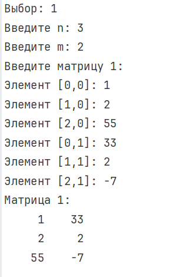
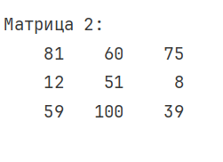

---

## Задача 2. Вторая матрица (шахматная раскраска)
### Текст задачи
Второй массив размерностью `n x n` заполняется случайными числами так, что нечетные числа заносятся в элементы, которые на шахматной доске были бы черными, а четные числа заносятся в элементы, которые были бы белыми.

### Алгоритм решения
1. Создается конструктор `Matrix(int n, int m, string type)`. Если передана строка `"chess"`, запускается заполнение.
2. Используется объект `Random` для генерации случайных чисел от 1 до 99.
3. В двойном цикле для каждого элемента `[i, j]` проверяется сумма индексов `(i + j) % 2`. Если сумма четная, клетка считается «черной» (туда нужно нечетное число). Если нечетная — «белой» (туда нужно четное).
4. Если сгенерированное число не соответствует требуемой четности, оно увеличивается на 1 (`num++`).

### Тестирование
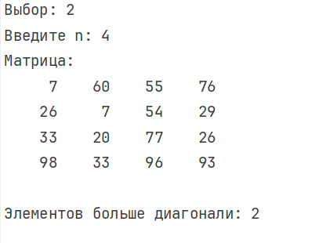

---

# Задание 2. Поиск элементов больше диагонали

## Задача 1
### Текст задачи
Определите, сколько элементов двумерного массива больше любого элемента главной диагонали.

### Алгоритм решения
1. Для работы используется квадратная матрица, создаваемая через конструктор со строкой `"chess"` (она заполняется случайными числами).
2. В методе `Task2()` сначала находится максимальный элемент на главной диагонали. Для этого используется цикл, который проходит по элементам `_data[i, i]` (где индексы строки и столбца совпадают).
3. Затем двойной цикл проходит по **всем** элементам матрицы. Каждый элемент сравнивается с найденным максимумом.
4. Если элемент больше максимума, счетчик `count` увеличивается. Выводится итоговое количество.

### Тестирование

---

# Задание 3. Матричное выражение

## Задача 1
### Текст задачи
Вычислить матричное выражение `A * C^T + B * C`.

### Алгоритм решения
1. В статическом методе `Task3(int n)` создаются три квадратные матрицы `A`, `B` и `C` размера `n x n` с помощью конструктора `"chess"`.
2. Вызывается метод `Transpose()`, который создает новую матрицу и заполняет её, меняя индексы местами (`result.Data[j, i] = _data[i, j]`). Так получается `C^T`.
3. Для умножения матриц перегружен оператор `*`. Внутри него создается результирующая матрица, и с помощью тройного цикла (где `k` — общий индекс для строки первой матрицы и столбца второй) вычисляются элементы.
4. Для сложения перегружен оператор `+`, который поэлементно складывает две матрицы.
5. Итоговое выражение записывается как `Matrix result = a * cT + b * c;` благодаря перегрузке операторов.

### Тестирование
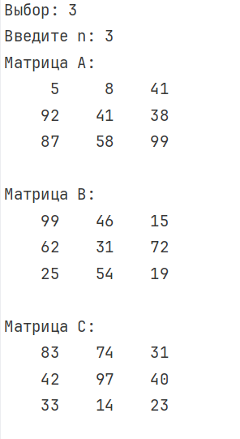
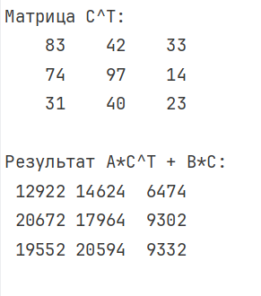
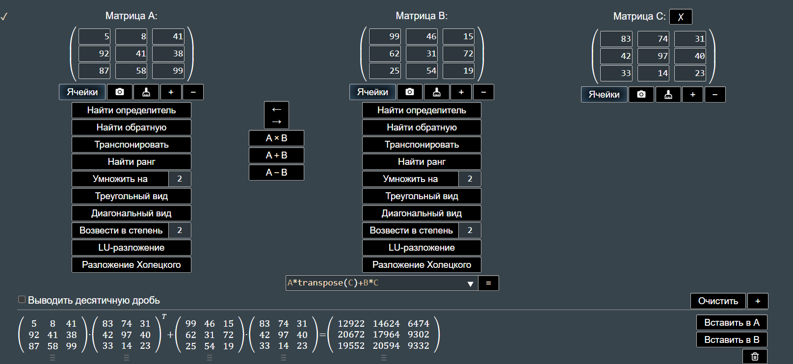

---

# Задание 4. Бинарные файлы

## Задача 1
### Текст задачи
Найти количество удвоенных нечетных чисел среди компонент файла.

### Алгоритм решения
1. В отдельном методе `CreateAndFillFile4` создается бинарный файл. С помощью `BinaryWriter` в него записываются 20 случайных чисел.
2. В методе `Task4` с помощью `BinaryReader` файл читается до конца (пока позиция в потоке меньше длины файла).
3. Каждое число проверяется: если оно четное (`num % 2 == 0`) и его половина нечетная (`(num / 2) % 2 != 0`), счетчик увеличивается.
4. Выводится содержимое файла (для наглядности) и итоговое количество.

### Тестирование
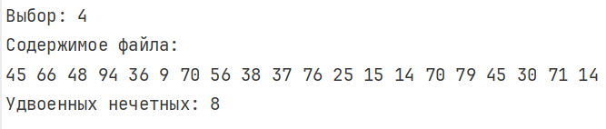

---

# Задание 5. Структуры и XML-сериализация

## Задача 1
### Текст задачи
Файл содержит сведения об игрушках: название, стоимость и возрастные границы. Получить название самой дешевой игрушки. Использовать XML-сериализацию.

### Алгоритм решения
1. Создается структура `Toy` с атрибутом `[Serializable]`. Внутри структуры объявляются публичные автосвойства (`Name`, `Price`, `MinAge`, `MaxAge`), так как `XmlSerializer` работает только с публичными свойствами.
2. В отдельном методе `CreateAndFillToys` создается список `List<Toy>` и заполняется тестовыми данными.
3. Создается объект `XmlSerializer`, который принимает тип `typeof(List<Toy>)`. С помощью метода `Serialize` данные записываются в файл `.xml`.
4. Для чтения используется метод `Deserialize`, который восстанавливает список объектов из файла.
5. В цикле перебираются все игрушки, ищется минимальная цена (сравнение `Price`), запоминается имя.

### Тестирование
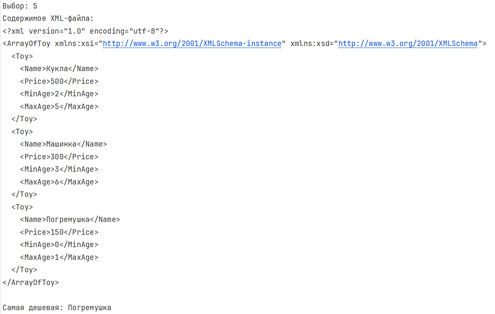

---

# Задание 6. Текстовый файл (max/min)

## Задача 1
### Текст задачи
В текстовом файле хранятся целые числа по одному в строке. Найти квадрат разности максимального и минимального элементов.

### Алгоритм решения
1. В отдельном методе `CreateAndFillFile6` с помощью `StreamWriter` создается текстовый файл, куда построчно записываются 15 случайных чисел.
2. В методе `Task6` с помощью `StreamReader` файл читается построчно. Каждая строка преобразуется в число через `int.TryParse`.
3. В процессе чтения обновляются переменные `min` и `max`.
4. После чтения вычисляется разность `max - min`, возводится в квадрат и выводится на экран.

### Тестирование
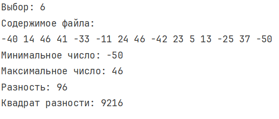

---

# Задание 7. Текстовый файл (сумма нечетных)

## Задача 1
### Текст задачи
В текстовом файле хранятся целые числа по несколько в строке. Вычислить сумму нечетных элементов.

### Алгоритм решения
1. В отдельном методе `CreateAndFillFile7` файл создается через `StreamWriter`, в каждую строку записывается по 3 случайных числа через пробел.
2. Файл читается через `StreamReader` построчно.
3. Каждая строка разбивается на массив строк с помощью метода `Split` (разделитель — пробел, с опцией `RemoveEmptyEntries`).
4. Каждый элемент массива парсится в число. Если число нечетное (`num % 2 != 0`), оно добавляется к общей сумме.
5. Выводится результат.

### Тестирование
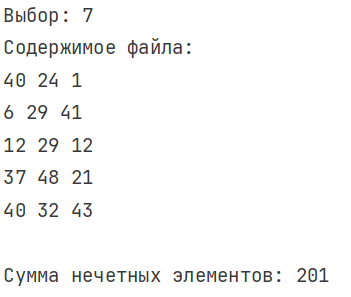

---

# Задание 8. Текстовый файл (последние символы)

## Задача 1
### Текст задачи
Создать новый текстовый файл, каждая строка которого содержит последний символ соответствующей строки исходного файла.

### Алгоритм решения
1. В отдельном методе `CreateInputFile8` создается исходный файл через `File.WriteAllLines` с массивом строк (включая пустую строку для проверки).
2. Файл считывается целиком в массив строк с помощью `File.ReadAllLines`.
3. Создается новый файл через `StreamWriter`. В цикле перебираются все строки исходного файла.
4. Если строка не пустая (`line.Length > 0`), берется ее последний символ `line[line.Length - 1]` и записывается в новый файл. Иначе записывается пустая строка.
5. Выводится содержимое обоих файлов.

### Тестирование
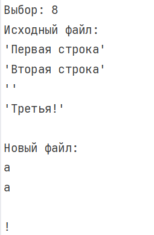
